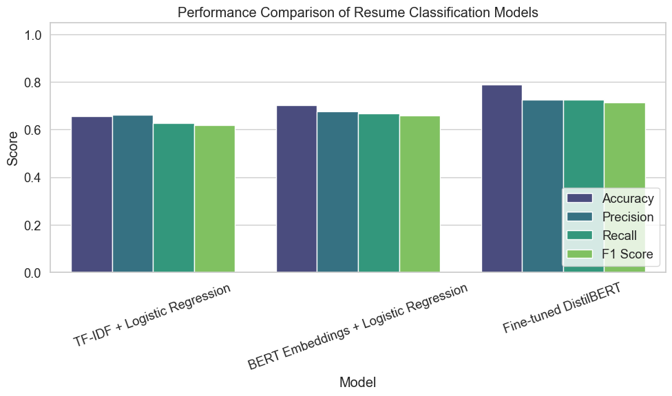
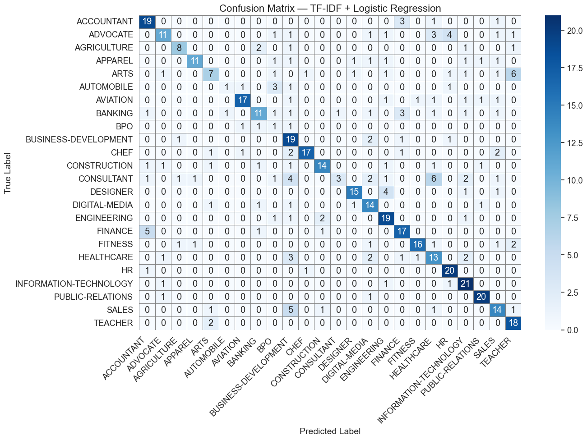
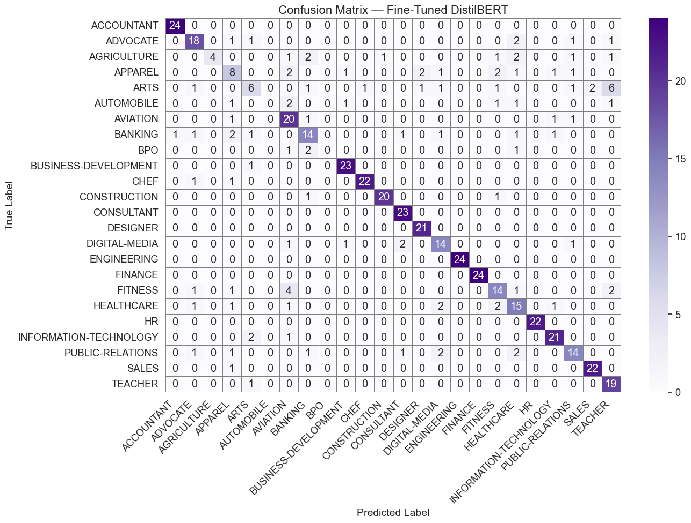

# Internship Engine ⚡

A real-time resume classification and semantic matchmaking engine. It uses a **fine-tuned DistilBERT** model to categorize resumes into 24 industry sectors, paired with a **Pinecone vector database** powered by **Gemini embeddings** to match candidates with relevant internship roles.

---

## 🧪 Model Training & Evolution Timeline

To classify raw resumes into 24 distinct domains, I tested three approaches in [`ml/main.ipynb`](ml/main.ipynb)—moving from a classical bag-of-words baseline to dense sentence embeddings, and finally fine-tuning a transformer model.

```
┌────────────────────────────────┐
│ 1. TF-IDF + LogisticRegression │ ──> Accuracy: 65.59% | Macro F1: 0.618
│    (Baseline: n-grams 1-2)     │     Why: Fast baseline to evaluate keyword frequency.
└───────────────┬────────────────┘
                │
                ▼
┌────────────────────────────────┐
│ 2. Sentence-BERT (MiniLM-L6)   │ ──> Accuracy: 70.22% | Macro F1: 0.660
│    + LogisticRegression        │     Why: Capture dense semantic meaning beyond exact word matches.
└───────────────┬────────────────┘
                │
                ▼
┌────────────────────────────────┐
│ 3. Fine-Tuned DistilBERT       │ ──> Accuracy: 78.87% | Macro F1: 0.713
│    (Sequence Classification)   │     Why: Adapt transformer self-attention directly to resume syntax & jargon.
└────────────────────────────────┘
```

### Performance Breakdown

| Stage | Model Architecture | Accuracy | Precision (Macro) | Recall (Macro) | F1 Score (Macro) | Why This Step? |
| :--- | :--- | :---: | :---: | :---: | :---: | :--- |
| **01** | **TF-IDF + Logistic Regression** | 65.59% | 66.07% | 62.66% | 0.618 | Quick baseline. Struggled with synonyms and overlapping tech terminology. |
| **02** | **SBERT (`all-MiniLM-L6-v2`) + LogReg** | 70.22% | 67.71% | 66.73% | 0.660 | Fixed exact-word dependency, but static embeddings weren't specialized for CV layouts. |
| **03** | **Fine-Tuned DistilBERT** | **78.87%** | **72.45%** | **72.53%** | **0.713** | End-to-end gradient updates tuned all self-attention layers on resume text. |

### Metric Comparison


---

### Confusion Matrices: Baseline vs. Fine-Tuned

The confusion matrices show why the fine-tuning step was necessary across the 24 classes:

#### Baseline: TF-IDF + Logistic Regression
Noticeable off-diagonal scatter where related categories (e.g., Information Technology, Software, Business Development) cross-pollinate due to shared tokens.


#### Final Model: Fine-Tuned DistilBERT
The diagonal tightens considerably across all 24 classes, demonstrating that the attention layers learned the contextual distinction between adjacent roles rather than relying on surface keywords.


---

## 🎯 How the Match-Making System Works

Classification only tells you what field a candidate is in; it doesn't tell you which specific internship they fit. That's where the vector retrieval pipeline comes in.

```
[Resume PDF / Query] 
        │
        ├──> (1) DistilBERT  ──> Top Domain Prediction (e.g., "Information-Technology: 84%")
        │
        └──> (2) Gemini Embeddings (text-embedding-004) ──> 768-dim Vector
                                                                    │
                                                                    ▼
                                                    [Pinecone Serverless Index]
                                                                    │  (Cosine Similarity)
                                                                    ▼
                                                    [Ranked Candidate / Job Matches]
```

### 1. Document Representation
Each candidate/internship profile is converted into a structured document containing skills, domain sector, education level, and preferred location:
```javascript
"Skills: React, Node.js, TypeScript, Job Sector: fullstack dev, Education: btech, Location: bangalore"
```

### 2. High-Dimensional Vectorization (Gemini Embeddings)
Instead of sparse keyword search, the system runs the query and profiles through Google's `text-embedding-004` model. This maps candidate qualifications and recruiter requirements into a **768-dimensional continuous vector space** where semantically related concepts sit close together (e.g., `"MERN"` naturally clusters near `"React + Node"`).

### 3. Pinecone Index & Cosine Similarity
- The vectors are indexed in a serverless **Pinecone** index (`metric: cosine`).
- When a resume or search prompt comes in, it calculates the cosine angle between the query vector and all profile vectors in milliseconds.
- Returns the top-$k$ nearest neighbors ranked with match percentages and skill overlap highlights.
- **Resilient Fallback**: If external API quotas or networks drop, a local BM25/cosine semantic ranker takes over automatically with zero downtime.

---

## 🚀 Running the Project

### 1. Setup Environment
Create a `.env` file in the root (see `.env.example`):
```env
GEMINI_API_KEY=your_gemini_api_key
PINECONE_API_KEY=your_pinecone_api_key
PINECONE_ENVIRONMENT=us-east-1
PINECONE_INDEX_NAME=internship
```

### 2. Launch (One Command)
```bash
npm run dev
```
Starts all three layers at once:
- **ML Inference Server** (Python/Flask + CUDA): `http://localhost:5000`
- **Backend API** (Node/Express): `http://localhost:3001`
- **Frontend SPA** (Vite + React): `http://localhost:5173`

---

## 📁 Project Architecture

```text
├── backend/
│   ├── server.js               # Express API (ports & routes)
│   ├── services/
│   │   ├── vectorService.js    # Pinecone + Gemini embeddings & fallback search
│   │   └── mlClient.js         # Flask bridge & regex skill extraction
│   └── data/profiles.js        # 95 curated candidate & internship records
├── ml/
│   ├── app.py                  # Flask inference server for DistilBERT
│   ├── main.ipynb              # Training notebook (TF-IDF, SBERT, DistilBERT)
│   └── resume_bert_finetuned/  # Model weights (tracked with Git LFS)
├── frontend/
│   ├── src/
│   │   ├── components/         # ResumeClassifier, OpportunityMatcher, ProfileExplorer
│   │   └── index.css           # Minimalist design system
│   └── vite.config.js          # API proxy setup
└── start-dev.js                # Full-stack orchestrator
```
